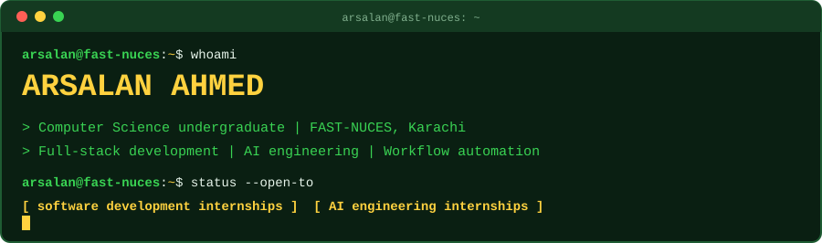
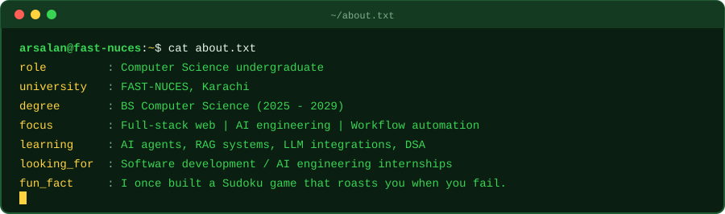
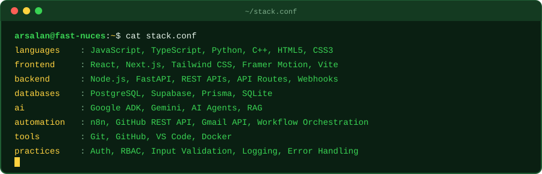
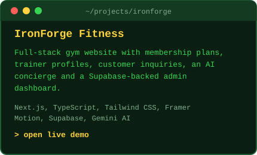
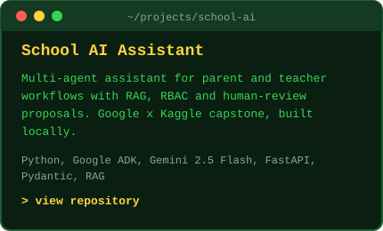
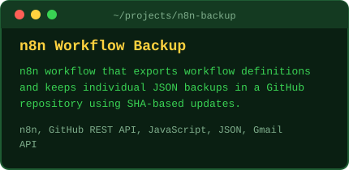
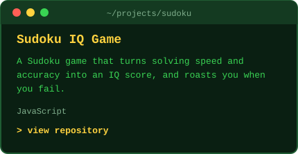
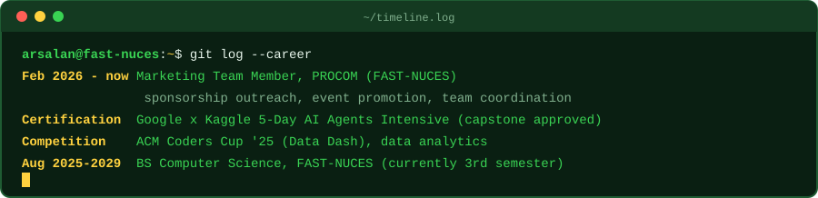

<!-- Profile README for github.com/Arsalan-Ahmed006
     Put this file at the root of a repo named exactly "Arsalan-Ahmed006", together with the "assets" folder. -->

<div align="center">



<a href="https://github.com/Arsalan-Ahmed006">
  
</a>

<br/>

<a href="https://www.linkedin.com/in/arsalan-ahmed-4b025628b/"></a>
<a href="mailto:arsalann.ahmad06@gmail.com"></a>
<a href="https://ironforge-gym-website-snowy.vercel.app/"></a>

</div>

<br/>

<div align="center">
  
</div>

<br/>

<div align="center">
  
</div>

<br/>

<div align="center">

### `> ls ~/projects`

<a href="https://ironforge-gym-website-snowy.vercel.app/"></a>
<a href="https://github.com/Arsalan-Ahmed006/school-ai-assistant"></a>

<a href="https://github.com/Arsalan-Ahmed006/Sudoku-iq-Game"></a>

</div>

<br/>

<details>
<summary><b>$ cat ironforge/features.txt</b></summary>
<br/>

- Responsive, multi-page gym website with membership plans, training programs, trainer profiles, and customer inquiry functionality
- AI-powered Concierge using Gemini AI that answers gym-related questions and guides visitors through available services
- Supabase-backed administrative dashboard for managing customer inquiries and application data

</details>

<details>
<summary><b>$ cat school-ai-assistant/features.txt</b></summary>
<br/>

- Multi-agent educational assistant using Google's Agent Development Kit (ADK) and Gemini
- Knowledge-based parent FAQ answering and teacher lesson-plan generation using retrieval-augmented generation (RAG)
- Authentication, role-based access control (RBAC), permission checks, and fail-closed knowledge retrieval to protect sensitive school information
- Safeguarding-oriented request classification, evidence references, audit-oriented workflow controls, and human-review action proposals
- Locally developed capstone project, not a public production deployment

</details>

<details>
<summary><b>$ cat n8n-backup/features.txt</b></summary>
<br/>

- n8n workflow that exports workflow definitions and stores individual JSON backups in a GitHub repository
- GitHub REST API integration that creates new backup files and updates existing ones using SHA-based version handling
- Sequential workflow processing, JSON data transformation, and Gmail notifications reporting backup results

</details>

<br/>

<div align="center">
  
</div>

<br/>

<div align="center">

### `> git stats`


<br/>

```text
while (alive) { learn(); build(); ship(); }
```


</div>
