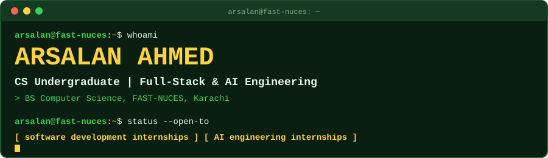
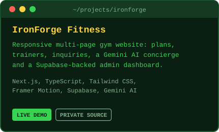
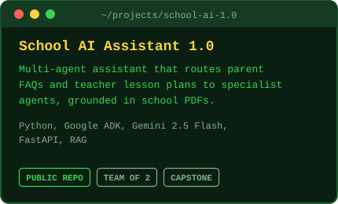
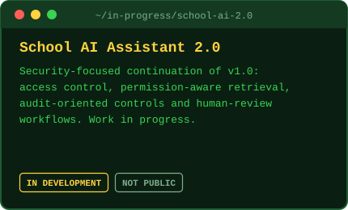

<div align="center">



<a href="https://linkedin.com/in/arsalan-ahmed-4b025628b">LinkedIn</a> &nbsp;|&nbsp;
<a href="mailto:arsalann.ahmad06@gmail.com">Email</a> &nbsp;|&nbsp;
<a href="https://ironforge-gym-website-snowy.vercel.app/">IronForge live demo</a>

</div>

### `> about`

I'm a Computer Science undergraduate at FAST-NUCES, Karachi, building full-stack web applications and AI-powered systems. I work across Next.js and TypeScript frontends, Supabase and PostgreSQL data layers, and Python and FastAPI backends, and I automate workflows with n8n and API integrations.

I'm especially interested in the engineering that makes AI features dependable: grounded retrieval, input validation, access control and human review. I'm currently building School AI Assistant 2.0, a security-focused continuation of my Google × Kaggle capstone.

I'm looking for software development and AI engineering internships.

### `> stack`

```text
$ cat stack.conf
programming : JavaScript, TypeScript, Python, C++
frontend    : React.js, Next.js, HTML5, CSS3, Tailwind CSS,
              Framer Motion
backend     : FastAPI, REST APIs, API Routes, Webhooks
databases   : PostgreSQL, Supabase
ai          : Google ADK, Gemini, AI Agents, RAG
automation  : n8n, Workflow Orchestration, API Integration,
              GitHub REST API, Gmail Integration
tools       : Git, GitHub, VS Code, Antigravity
practices   : Authentication, RBAC, Input Validation, Logging,
              Error Handling
```

### `> featured_projects`

<div align="center">
<a href="https://ironforge-gym-website-snowy.vercel.app/"></a>
</div>

<div align="center">
<a href="https://github.com/Arsalan-Ahmed006/school-ai-assistant"></a>
</div>

<br/>

| Project | Details |
|---|---|
| **IronForge Fitness** | Responsive multi-page gym website with membership plans, training programs, trainer profiles and customer inquiry functionality. A Gemini-powered AI Concierge answers gym-related questions and guides visitors through services, and a Supabase-backed administrative dashboard manages customer inquiries and application data.<br/><br/>**Links:** [Live demo](https://ironforge-gym-website-snowy.vercel.app/) · **Source code: private** (the live site does not expose it) |
| **School AI Assistant 1.0** | Google × Kaggle 5-Day AI Agents Intensive capstone (submitted and approved). A multi-agent educational assistant built with Google ADK: a root agent routes parent enquiries and teacher lesson-planning requests to specialist agents, which answer using school policy and curriculum PDFs through retrieval tools. Runs locally through the ADK playground and a FastAPI server; not a deployed product.<br/><br/>**Team of two.** My part: Parent FAQ agent, Google ADK integration, tool calling, RAG and FastAPI integration. Manzar Rasool: Teacher Lesson Planning agent, security guardrails, testing and documentation, as credited in the repository README.<br/><br/>**Links:** [Public repository](https://github.com/Arsalan-Ahmed006/school-ai-assistant) |

### `> currently_building`

<div align="center">

</div>

<br/>

**School AI Assistant 2.0** is a separate, more advanced continuation of the school assistant. Version 1.0 is a capstone prototype that demonstrates multi-agent routing and grounded retrieval; version 2.0 focuses on a security-focused backend architecture and responsible AI workflow controls. Development scope includes:

- Authentication and identity handling
- Role-based access control (RBAC)
- Permission-aware, fail-closed knowledge retrieval
- Safeguarding-oriented request classification
- Evidence references and audit-oriented workflow controls
- Human-review action proposals
- Automated tests and backend security architecture

**Status:** in development. It is not deployed yet, and there is no public repository at this stage. A public deployment is planned once development is complete.

### `> additional_projects`

| Project | Stack | What it does | Source |
|---|---|---|---|
| **n8n Workflow Backup Automation** | n8n, GitHub REST API, Gmail API, JavaScript, JSON | Exports n8n workflow definitions and keeps an individual JSON backup of each in a GitHub repository. Creates new files and updates existing ones through SHA-based version handling, processes workflows sequentially, and emails the backup results through Gmail. | Private |
| **Sudoku IQ Game** | JavaScript, HTML, CSS | Sudoku game featuring a countdown timer, duplicate validation, an accuracy-weighted IQ-style score, local score history, and score-based feedback. | [Repository](https://github.com/Arsalan-Ahmed006/Sudoku-iq-Game) |
| **Quiz Game** (The Dark Quiz) | JavaScript, HTML, CSS | Timed coding quiz covering six programming and web technologies, with multiple question formats, lives, level progression, per-question timers, and local progress persistence. | [Repository](https://github.com/Arsalan-Ahmed006/Quiz-Game) |

### `> education_and_experience`

```text
$ cat timeline.log
Aug 2025 - Jul 2029   BS Computer Science
                      FAST-NUCES, Karachi

Feb 2026 - present    Marketing Team Member, PROCOM
                      FAST-NUCES
                      - Sponsorship outreach and professional
                        communication with prospective sponsors
                      - Event marketing and promotional campaigns
                      - Team coordination
```

### `> certifications_and_activities`

```text
$ cat activities.log
Google x Kaggle - 5-Day AI Agents Intensive
  Practical AI agent development training; submitted a
  capstone project that was approved.

ACM Coders Cup '25 - Data Dash (participant)
  Data analytics competition involving messy datasets,
  data interpretation and analytical problem-solving.
```

### `> contact`

- **Email:** [arsalann.ahmad06@gmail.com](mailto:arsalann.ahmad06@gmail.com)
- **LinkedIn:** [linkedin.com/in/arsalan-ahmed-4b025628b](https://linkedin.com/in/arsalan-ahmed-4b025628b)
- **GitHub:** [github.com/Arsalan-Ahmed006](https://github.com/Arsalan-Ahmed006)
- **IronForge live demo:** [ironforge-gym-website-snowy.vercel.app](https://ironforge-gym-website-snowy.vercel.app/)
